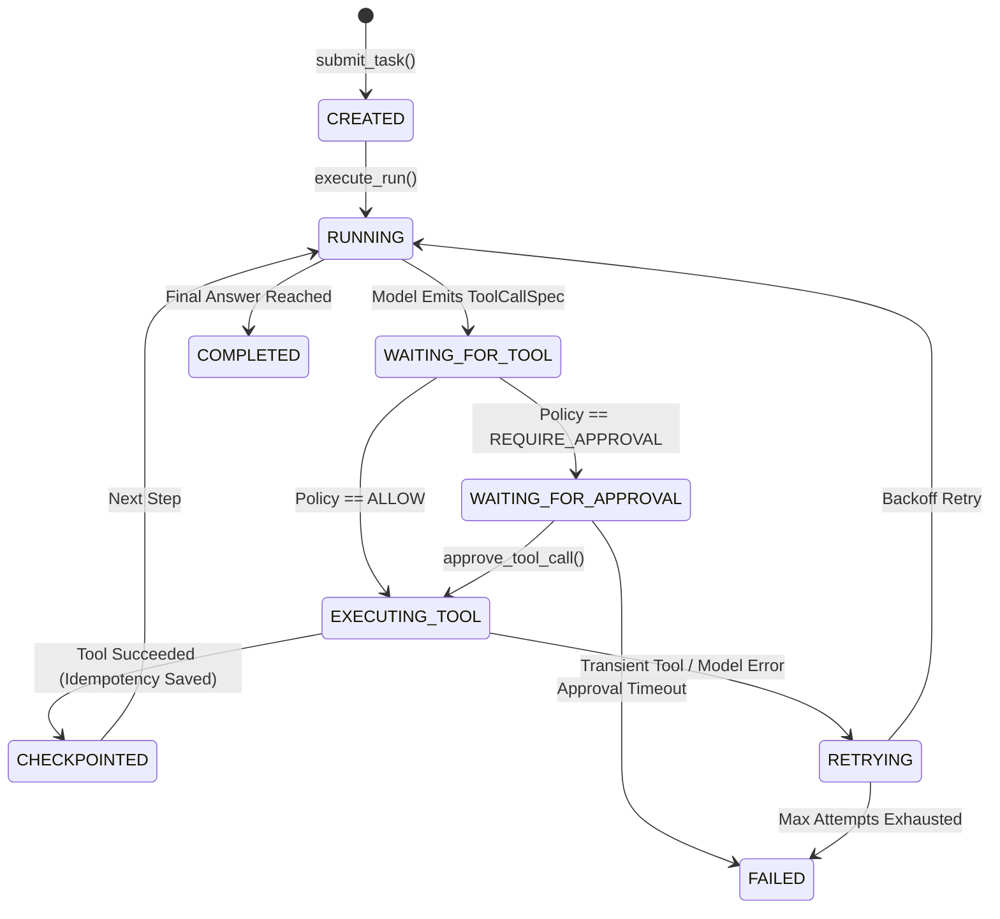

# Axiom Runtime

**Stateful AI Agent Execution Engine with Durable Checkpointing, Idempotent Tool Execution, Policy Gates, and Observability.**

> *"Companies don't need another chatbot. They need engineers who can turn experimental agents into dependable software systems."*

---

## 1. Overview & Motivation

Most agent prototypes work well in demonstrations but fail in production when execution state is lost between sessions, tool calls fail without recovery, concurrent tasks race, or retrying a crashed step repeats an external side effect.

**Axiom Runtime** is the flagship execution engine of the **Agentic Systems Engineering Lab** portfolio. It implements the execution layer responsible for the complete lifecycle of an agent task:

| Subsystem | Module | Responsibility |
| :--- | :--- | :--- |
| **Execution Engine** | `axiom.engine.runner` | Controls the deterministic agent execution lifecycle |
| **State Machine** | `axiom.engine.state_machine` | Enforces legal `RunStatus` transitions and terminal invariants |
| **State Manager** | `axiom.state.store` | Persists runs, checkpoints, tool invocations, approvals & optimistic locks |
| **Tool Registry** | `axiom.tools.registry` | Validates tool schemas (Pydantic v2), exports MCP descriptors & deduplicates calls |
| **Policy Engine** | `axiom.policy.engine` | Enforces `ALLOW`, `REQUIRE_APPROVAL` (HITL), and `DENY` rules |
| **LLM Gateway** | `axiom.gateway.adapter` | Abstracts model provider APIs with unified token/latency telemetry |
| **Observability** | `axiom.schemas.domain` | Emits structured `TraceEvent` timelines and canonical `FailureCategory` classifications |

---

## 2. Execution State Machine



---

## 3. Quick Start

### Run the Test & Fault-Injection Suite
```bash
cd axiom-runtime
pytest -v
```

### Working Demonstration: Research-and-Reporting Agent
The included demonstration (`src/axiom/demo/research_agent.py`) runs a multi-step agent that searches documents, synthesizes findings, pauses for human approval before publishing externally, and recovers deterministically across six injected failure modes:

1. **Model API Timeout** (`FailureCategory.MODEL_TIMEOUT`)
2. **Transient Tool Failure** (`FailureCategory.TOOL_FAILURE`)
3. **Mid-Step Worker Interruption & Idempotent Checkpoint Recovery** (`FailureCategory.WORKER_INTERRUPTION`)
4. **Duplicate Task Submission Deduplication** (`FailureCategory.DUPLICATE_SUBMISSION`)
5. **Invalid Tool Argument Schema Rejection** (`FailureCategory.INVALID_TOOL_ARGUMENTS`)
6. **Human Approval Deadline Expiration** (`FailureCategory.APPROVAL_TIMEOUT`)

---

## 4. Engineering Benchmarks & Reliability Metrics

| Metric | Target / Verified | What It Demonstrates |
| :--- | :---: | :--- |
| **Execution Success Rate** | `100%` (valid runs) | End-to-end reliability across multi-step tool workflows |
| **Crash Recovery Success Rate** | `100%` | Resuming interrupted runs from the latest persisted checkpoint |
| **Duplicate Tool Execution Rate** | `0.0%` | Idempotency key (`sha256(run_id:step:tool:args)`) effectiveness on crash retry |
| **Optimistic Concurrency Detection** | `100%` | Version-checked state transitions preventing race conditions |

---

## 5. Repository Structure

```text
axiom-runtime/
├── docs/
│   ├── 01-scope-and-non-goals.md
│   └── 02-architecture-spec.md
├── src/axiom/
│   ├── demo/research_agent.py
│   ├── engine/
│   │   ├── runner.py
│   │   └── state_machine.py
│   ├── gateway/adapter.py
│   ├── policy/engine.py
│   ├── schemas/domain.py
│   ├── state/
│   │   ├── models.py
│   │   └── store.py
│   └── tools/registry.py
├── tests/
│   ├── test_state_machine.py
│   └── test_fault_injection.py
├── docker-compose.yml
├── pyproject.toml
└── README.md
```
