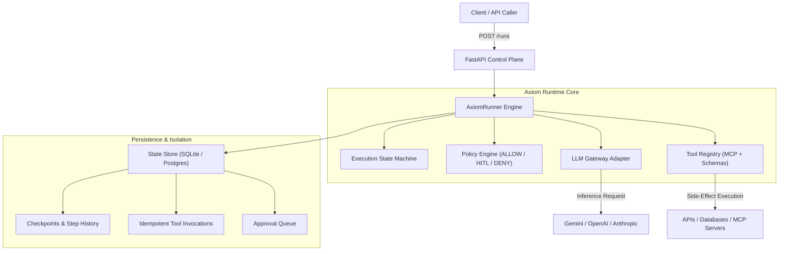

# Axiom Runtime: Architecture Specification

## 1. System Topology

---

## 2. Core Execution Invariants

1. **Pre-Invocation Recording**:
   A tool invocation record with status `PENDING` and a deterministic idempotency key must be committed to the state store **before** the tool function is invoked.

2. **Optimistic Concurrency Control (OCC)**:
   State updates to `AgentRun` require matching `version` increments. Any concurrent conflict aborts with `STATE_CONFLICT` to prevent split-brain execution across multiple workers.

3. **Checkpoint Granularity**:
   Every state transition produces a checkpoint snapshot containing serialized conversation context, tool history, and variable bindings.

4. **Failure Category Normalization**:
   Exceptions are caught, categorized using the standard 6-category failure taxonomy, and logged as structured `TraceEvent` records before triggering recovery or terminal transitions.

---

## 3. Data Schema & Models

- **`AgentRun`**: Represents the full execution lifecycle of a task instance. Contains `run_id`, `agent_name`, `status`, `current_step`, `version`, `config`, and `deadline_at`.
- **`ExecutionStep`**: Detailed log of each turn including `state_from`, `state_to`, token usage, latency, and payloads.
- **`ToolInvocation`**: Record of tool execution with unique `idempotency_key`, arguments, execution status, and cached output.
- **`ApprovalRequest`**: HITL request record tracking risk evaluation, supervisor assignments, and approval decisions.
