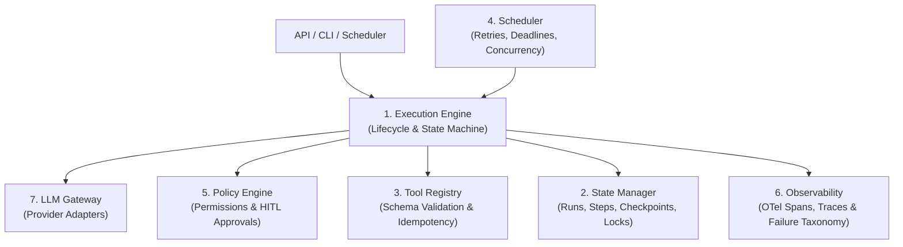

# Axiom Runtime: Architecture Specification

## 1. Architectural Overview
Axiom Runtime is structured as a **modular monolith** comprising six core engineering subsystems plus a provider-agnostic LLM Gateway. Each subsystem communicates strictly through typed Pydantic v2 contracts and Python `Protocol` interfaces so any layer can be tested, replaced, or scaled independently.

## 2. Subsystem Contracts

### 2.1 Execution Engine (`axiom.engine`)
- Drives an `AgentRun` through validated state transitions defined in `state_machine.py`.
- Never holds unpersisted state across external I/O boundaries: every state transition is committed to the `StateStore` before and after model generation or tool invocation.

### 2.2 State Manager (`axiom.state`)
- Persists `AgentRun`, `ExecutionStep`, `ToolInvocationRecord`, `Checkpoint`, and `ApprovalRequest`.
- Enforces **run-level idempotency** (preventing duplicate task submissions via `idempotency_key`) and **optimistic concurrency control** (incrementing `version` on every state mutation).
- Supports instant checkpoint restoration (`resume_run(run_id)`) from any interrupted step.

### 2.3 Tool Registry (`axiom.tools`)
- Registers callable tools paired with Pydantic v2 input models and risk policies.
- Computes a deterministic **tool idempotency key**:
  `sha256(f"{run_id}:{step_index}:{tool_name}:{canonical_json(arguments)}")`
- Before executing a tool, checks the `StateStore` for an existing `COMPLETED` `ToolInvocationRecord` with that key. If found, returns the cached output without re-executing the external side effect.

### 2.4 Scheduler & Retry Controller (`axiom.scheduler`)
- Evaluates bounded retry policies (`max_attempts`, `initial_backoff_ms`, `multiplier`, `retryable_categories`).
- Distinguishes between:
  - **Transient errors** (`MODEL_TIMEOUT`, `TOOL_TRANSIENT_ERROR`) → transition to `RETRYING` and re-attempt.
  - **Schema/validation errors** (`INVALID_TOOL_ARGUMENTS`) → feed structured validation error back to the model context or fail cleanly if retries are exhausted.
  - **Terminal errors** (`APPROVAL_TIMEOUT`, `POLICY_DENIED`, `DEADLINE_EXCEEDED`) → transition immediately to `FAILED`.

### 2.5 Policy Engine (`axiom.policy`)
- Inspects every proposed tool invocation before execution.
- Returns one of three decisions:
  - `PolicyDecision.ALLOW`: Proceed immediately to `EXECUTING_TOOL`.
  - `PolicyDecision.REQUIRE_APPROVAL`: Create an `ApprovalRequest`, checkpoint the run, and transition to `WAITING_FOR_APPROVAL`.
  - `PolicyDecision.DENY`: Reject the tool call and fail or inform the agent.

### 2.6 Observability & Failure Classification (`axiom.telemetry`)
- Records structured `TraceEvent` entries for every state transition, model call, tool invocation, retry, and approval gate.
- Classifies every failure into a canonical `FailureCategory` enum used by the downstream **Agent Evaluation Lab** (`Project 03`).
